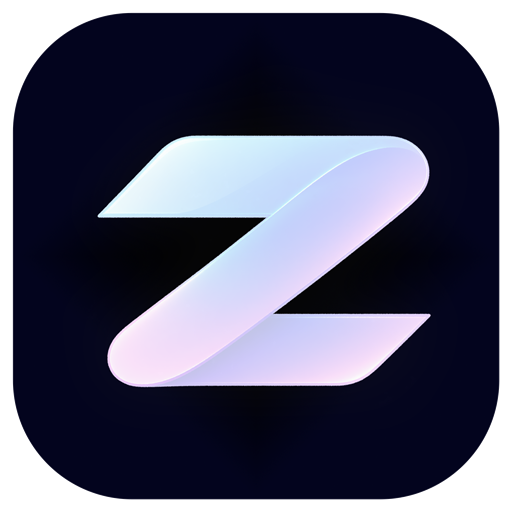
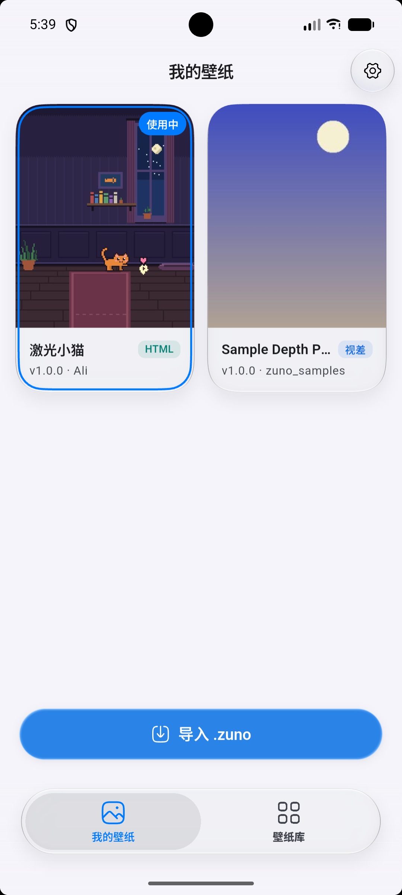
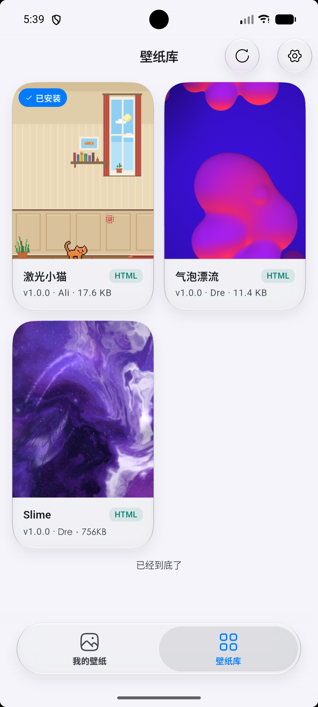

<p align="center">
  
</p>

<h1 align="center">ZUNO</h1>

<p align="center">
  <strong>Dynamic wallpapers for Android — video, depth parallax, HTML and timed wallpapers.</strong><br/>
  Flutter is only the management UI; everything on your home screen is drawn by a native <code>WallpaperService</code>, completely off Flutter's rendering path.
</p>

<p align="center">
  <a href="https://github.com/Zephyr-Isle/ZUNO/actions/workflows/ci.yml"></a>
  <a href="https://github.com/Zephyr-Isle/ZUNO/releases/latest"></a>
  <a href="LICENSE"></a>
</p>

<p align="center">
  English · <a href="README.zh-CN.md">简体中文</a>
</p>

---

## Table of contents

- [Features](#features)
- [Languages](#languages)
- [Screenshots](#screenshots)
- [Download & install](#download--install)
  - [Sample wallpaper packs](#sample-wallpaper-packs)
- [Building from source](#building-from-source)
  - [Android app](#android-app)
  - [Desktop admin](#desktop-admin)
  - [Backend (local development)](#backend-local-development)
- [Wallpaper packages](#wallpaper-packages)
  - [Layout](#layout)
  - [Manifest fields](#manifest-fields)
  - [Content requirements per type](#content-requirements-per-type)
  - [Checksum algorithm](#checksum-algorithm)
  - [Import validation order](#import-validation-order)
  - [Creating a package step by step](#creating-a-package-step-by-step)
- [Backend deployment](#backend-deployment)
  - [Option A: Docker self-hosting (recommended)](#option-a--docker-self-hosting-recommended)
  - [Option B: Cloudflare Workers](#option-b--cloudflare-workers)
  - [WebDAV layout](#webdav-layout)
  - [Pointing the app at your backend](#pointing-the-app-at-your-backend)
- [Credits](#credits)
- [License](#license)

## Features

- **Video wallpapers** — ExoPlayer writes frames straight into the wallpaper Surface, so there is essentially no extra copy after decoding. Decode mode is selectable (auto / hardware / software); a hardware failure is reported explicitly instead of silently degrading.
- **Depth parallax** — single-pass displacement mapping with EGL14 + GLES20, driven by the accelerometer and gyroscope. Packages may ship their own GLSL shader.
- **HTML wallpapers** — an offscreen WebView renders software frames onto the wallpaper Surface, sandboxed to `appassets.local` only; the renderer auto-freezes once the page stops animating.
- **Timed wallpapers** — WorkManager rotates sub-wallpapers ("slots") on schedule, hot-swapped in-process via `ConfigBus`. Platform minimum interval is 15 minutes.
- **Wallpaper packages** — a `.zuno` file is a plain ZIP with a manifest and checksum. Import blocks Zip Slip, path traversal, excessive `minSdk`, and recursively validates `timed` sub-packages.
- **Cloud catalog** — browsing and downloading need no account; download tickets expire in 5 minutes. Upload and deletion live in a separate desktop admin tool.
- **8 UI languages** — English, Simplified/Traditional Chinese, Japanese, Korean, Spanish, French and German, switchable in-app or following the system.

## Languages

The interface is available in 8 languages:

| Language | Code | Native name |
|---|---|---|
| English | `en` | English |
| Simplified Chinese | `zh` | 简体中文 |
| Traditional Chinese | `zh_Hant` | 繁體中文 |
| Japanese | `ja` | 日本語 |
| Korean | `ko` | 한국어 |
| Spanish | `es` | Español |
| French | `fr` | Français |
| German | `de` | Deutsch |

By default the app follows the system language. To override it, open **Settings → Language** and choose a language (or switch back to **Follow system**). The preference is stored in native config and loaded before the first frame, so the UI never flashes the wrong language at launch.

String catalogues live in `lib/l10n/strings_<code>.dart`; `ZunoStrings` is pure Dart (no Flutter imports) because ZIP import runs in a background isolate, which receives the active language code explicitly. To add a language, copy `strings_en.dart`, translate the values, then register the code in `ZunoStrings.supportedLanguageCodes` / `nativeNames` and add the locale to `ZunoLocalizations.supportedLocales`.

## Screenshots

<table>
  <tr>
    <td align="center"></td>
    <td align="center"></td>
  </tr>
  <tr>
    <td align="center"><b>My wallpapers</b><br/>installed packages, active state, import</td>
    <td align="center"><b>Wallpaper library</b><br/>cloud catalog with type &amp; size, one-tap download</td>
  </tr>
</table>

## Download & install

Grab the latest build from the [**Releases**](https://github.com/Zephyr-Isle/ZUNO/releases/latest) page:

- `ZUNO-<version>.apk` — universal APK (arm64 / armv7a / x86_64, Android 7.0+). Release-CI builds are debug-signed, which is fine for sideloading; to sign with your own key see [Building from source](#building-from-source).
- `*.zuno` — sample wallpaper packs, also usable as format references (see [the table below](#sample-wallpaper-packs)).

Steps:

1. Install the APK (allow "install unknown apps" if the system asks).
2. Open ZUNO → **Import** → pick a `.zuno` file (from Downloads, or shared from your file manager).
3. Tune parameters on the detail page → **Apply wallpaper** → confirm in the system wallpaper preview.

Android does not allow a regular app to set a live wallpaper silently — that last system-confirmation step is mandatory and cannot be skipped.

### Sample wallpaper packs

| Pack | Type | Size | Notes |
|---|---|---|---|
| [sample_depth](https://github.com/Zephyr-Isle/ZUNO/releases/latest) | depth | 3 KB | Generated demo: depth parallax with built-in assets |
| [sample_html](https://github.com/Zephyr-Isle/ZUNO/releases/latest) | html | 1 KB | Generated demo: minimal HTML wallpaper |
| [sample_timed](https://github.com/Zephyr-Isle/ZUNO/releases/latest) | timed | 3 KB | Generated demo: scheduled slot rotation |
| [lantern-sky](https://github.com/Zephyr-Isle/ZUNO/releases/latest) | html | 150 KB | Lantern night sky |
| [laser-kitty](https://github.com/Zephyr-Isle/ZUNO/releases/latest) | html | 20 KB | Laser kitty |
| [liquid-contour](https://github.com/Zephyr-Isle/ZUNO/releases/latest) | html | 241 KB | Liquid contour lines |
| [mycelium](https://github.com/Zephyr-Isle/ZUNO/releases/latest) | html | 190 KB | Mycelium flow |
| [particle-field](https://github.com/Zephyr-Isle/ZUNO/releases/latest) | html | 257 KB | Particle field |
| [rain](https://github.com/Zephyr-Isle/ZUNO/releases/latest) | html | 1.4 MB | Rain on glass (keeps its original `license.txt` and stock-photo attributions) |
| [slime](https://github.com/Zephyr-Isle/ZUNO/releases/latest) | html | 159 KB | Slime |
| [steam-glass](https://github.com/Zephyr-Isle/ZUNO/releases/latest) | html | 1.9 MB | Steam glass |

Most showcase packs are adapted from web wallpapers in the [Lively Wallpaper](https://github.com/rocksdanister/Lively) project. Each pack keeps whatever license its original author attached (see `content/license.txt` inside `rain`). Import them through the app like any other `.zuno`.

## Building from source

### Android app

Requirements: Flutter 3.47+ (Dart 3.13+), JDK 17, Android SDK with compileSdk 37.

```bash
flutter pub get
flutter run                 # debug build on a connected device / emulator
flutter build apk --release
```

- The release build emits 4 APKs under `build/app/outputs/apk/release/`: ABI splits for `armeabi-v7a`, `arm64-v8a`, `x86_64`, plus a universal APK. R8 minification is on.
- Without `android/key.properties`, the release build falls back to the debug signing key — it installs fine, just don't ship it as an official release. To sign properly, create `android/key.properties` (git-ignored) with `storeFile`, `storePassword`, `keyAlias`, `keyPassword` pointing at your keystore.
- The app version comes from `pubspec.yaml` (`version: 1.0.0+1` → `versionName` `1.0.0`, `versionCode` `1`); Gradle reads it automatically.
- Unit tests don't need a device: `flutter test` (the `samples/` directory doubles as a test fixture).

### Desktop admin

Tauri 2 app for uploading/managing the cloud catalog. Requirements: Node 22+, Rust stable, WebView2 (Windows).

```bash
cd desktop
npm install
npm run tauri dev      # Vite dev server on :1420 + debug window
npm run tauri build    # bundles under src-tauri/target/release/bundle/
```

### Backend (local development)

```bash
cd backend
npm install
npm run typecheck            # Worker code
npm run typecheck:selfhost   # Node self-hosting adapter
npm run dev                  # wrangler dev — D1 mapped to a local SQLite file
node tool/stub-webdav.mjs .tmp-dav 8799   # local WebDAV stub for integration testing
```

## Wallpaper packages

### Layout

A `.zuno` file is a ZIP (store or deflate both fine):

```
zuno-root/
├── manifest.json            # required, at root or inside a single top-level folder
├── thumbnail.png            # optional, suggested 480×800 and < 200 KB
└── content/                 # required, non-empty, all wallpaper assets
```

### Manifest fields

| Field | Description |
|---|---|
| `schemaVersion` | Currently fixed at `1` |
| `id` / `version` | id as a reverse-domain or UUID; re-importing the same id overwrites the old version; version is semver |
| `title` | Display name in the library |
| `type` | `video` / `depth` / `html` / `timed` |
| `entry` | Entry file path relative to the package root, must actually exist |
| `minSdk` | Defaults to 24; import is rejected if the device API level is lower |
| `checksum` | `sha256-` + lowercase hex, covering every file under `content/` |
| `config` | Tunable parameter declarations; supports float / int / bool / color |
| `capabilities` | Records `network` / `pointer` / `sensors`; in v1 network is recorded but not granted |

### Content requirements per type

- `video`: `content/main.mp4`, H.264/H.265, recommended ≤ 15 s loop.
- `depth`: `content/color.jpg` and `content/depth.png` (grayscale, same size, required), optional `content/shader.glsl`.
- `html`: `content/index.html` plus self-contained in-package assets — external CDNs are unreachable from the sandbox.
- `timed`: `content/schedule.json` plus `content/slot_*/`; each slot is a standalone sub-package, but nesting `timed` inside `timed` is rejected.

### Checksum algorithm

List every file under `content/` by its POSIX path relative to the package root, ascending. Feed `path UTF-8 bytes + 0x0A + file bytes` into a single SHA-256 state in that order. Write the result as `sha256-<lowercase hex>`.

### Import validation order

Path traversal → manifest exists → required fields → type → entry → content non-empty → minSdk → checksum → timed recursion. Any failure rejects the whole package with a concrete reason.

### Creating a package step by step

1. Create a source directory:

   ```
   my-wallpaper/
   ├── manifest.json
   └── content/
       └── index.html
   ```

2. Write a minimal manifest (HTML example):

   ```json
   {
     "schemaVersion": 1,
     "id": "com.example.my-wallpaper",
     "version": "1.0.0",
     "title": "My Wallpaper",
     "type": "html",
     "entry": "content/index.html"
   }
   ```

3. Pack it — either way the checksum is recomputed for you:
   - **Desktop admin**: *Pack from source directory* validates the manifest and entry, recomputes the checksum, and auto-generates `thumbnail.png` when missing.
   - **CLI**: put your package directory (or several) under a staging folder, then

     ```bash
     dart run tool/pack_zuno.dart --src <staging directory> --out <output directory>
     ```

4. Import the resulting `.zuno` in the app to verify, then upload it with the desktop admin if you want it in your cloud catalog.

The packs under [`samples/`](samples/) are the best starting reference — each one unpacks to exactly this layout.

## Backend deployment

The backend (`backend/`) serves the app's wallpaper library: catalog listing, 5-minute download tickets, and full-file streaming proxy. It has no database server dependency — SQLite semantics only, one storage backend (WebDAV) for the actual packages.

### Option A: Docker self-hosting (recommended)

Two containers: `zuno-api` (this repo's backend, Node) and a WebDAV server for packages/covers. Total setup time: about 5 minutes.

```bash
git clone https://github.com/Zephyr-Isle/ZUNO
cd ZUNO/backend
cp selfhost.env.example .env          # fill in the secrets
cp webdav.example.yml webdav.yml      # default config is fine
docker compose up -d
curl http://127.0.0.1:8080/health     # {"ok":true,"database":"ok",...}
```

`.env` variables:

| Variable | Used by | Description |
|---|---|---|
| `WEBDAV_BASE` | zuno-api | WebDAV root URL. Keep `http://webdav:6065` (compose-internal service name) |
| `WEBDAV_USER` / `WEBDAV_PASS` | zuno-api | **Read-only** WebDAV account (`zuno-api` user); the Worker never writes |
| `TICKET_SECRET` | zuno-api | HMAC key for download tickets, ≥ 32 random bytes. Leak = forgeable download links only |
| `ADMIN_SECRET` | zuno-api | Password for `/api/admin/sync` and `/api/admin/delete` |
| `PBKDF2_ITERATIONS` | zuno-api | Password hashing cost; `100000` is comfortable without Cloudflare's 10 ms CPU cap |
| `WEBDAV_ADMIN_PASSWORD` | webdav | Password for the CRUD account the desktop admin uses |
| `WEBDAV_API_PASSWORD` | webdav | Password for the read-only account; must equal `WEBDAV_PASS` |

Generate secrets with `openssl rand -base64 32` (one per secret).

- Data lives in two named volumes: `zuno-db` (SQLite, via `DB_PATH=/data/zuno.db`) and `zuno-dav` (`packages/` + `covers/`).
- The server boots even with missing config: `/health` works, and affected endpoints answer `server_misconfigured` listing what's missing — check `docker compose logs zuno-api`.
- Upgrade: `docker compose pull && docker compose up -d` (or rebuild locally by uncommenting `build: .` in the compose file).

### Option B: Cloudflare Workers

The original deployment target — Workers + D1 + WebDAV (no R2). The Worker handles the API, auth, download tickets, and full-file streaming; D1 stores users, sessions, and wallpaper metadata; `.zuno` packages and covers sit on any WebDAV you point it at.

```bash
cd backend
npm install
cp wrangler.toml.example wrangler.toml   # fill in database_id, custom domain, WEBDAV_BASE

npx wrangler d1 create zuno
npm run db:init:local
npm run db:init:remote

npx wrangler secret put WEBDAV_USER
npx wrangler secret put WEBDAV_PASS
npx wrangler secret put TICKET_SECRET      # ≥ 32 random bytes
npx wrangler secret put ADMIN_SECRET

npm run deploy
```

Things that bite people on the free tier:

- Use a dedicated **read-only** WebDAV account scoped to the ZUNO directory, force HTTPS, use a long random password. Secrets only ever go through `wrangler secret`, never into the repo.
- Downloads are streamed as whole files; no `206` or resume. Workers' `fetch` strips `Range` on subrequests, so the upstream always answers 200 — the client treats a full file as success.
- The free tier allows 10 ms CPU per request, so PBKDF2 runs 10000 iterations. When syncing packages, don't scan everything at once — use `POST /api/admin/sync?id=<id>` per package, or page through with `offset`/`limit` until `nextOffset` is null.

### WebDAV layout

```
<WEBDAV_BASE>/
  packages/<id>/<version>/<id>-<version>.zuno
  covers/<id>.png
```

Each version directory should also contain a `manifest.json` sidecar (the desktop admin writes it automatically on upload). Without it, the Worker can only extract the manifest from the ZIP itself for packages ≤ 16 MB; larger packages get skipped.

### Pointing the app at your backend

ZUNO ships with **no built-in server**. Open the app → *Settings* → *Wallpaper library address* → enter your deployment's base URL (e.g. `https://api.example.com` or `http://192.168.1.10:8080`). Saving rebuilds the catalog immediately; *Clear address* returns the library tab to its "not configured" guide.

## Credits

- [Lively Wallpaper](https://github.com/rocksdanister/Lively) — most showcase packs are adapted from its web wallpaper collection.
- [liquid_glass_widgets](https://pub.dev/packages/liquid_glass_widgets) — the liquid-glass UI system.
- [Media3 / ExoPlayer](https://github.com/androidx/media) — video decoding.
- [Tauri](https://v2.tauri.app/) — the desktop admin app.
- [hacdias/webdav](https://github.com/hacdias/webdav) — the bundled self-hosting WebDAV server.
- Stock photography inside the `rain` pack is attributed in its `content/license.txt` (Pexels / Unsplash).

## License

This project is [MIT licensed](LICENSE). Wallpaper packs keep their own licenses and attributions — check `manifest.json` and any `content/license.txt` before redistributing them.
