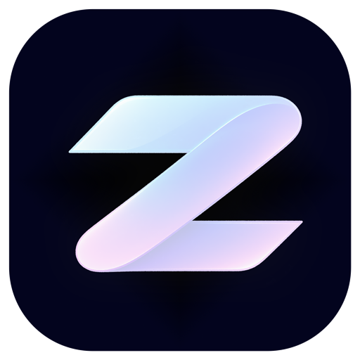
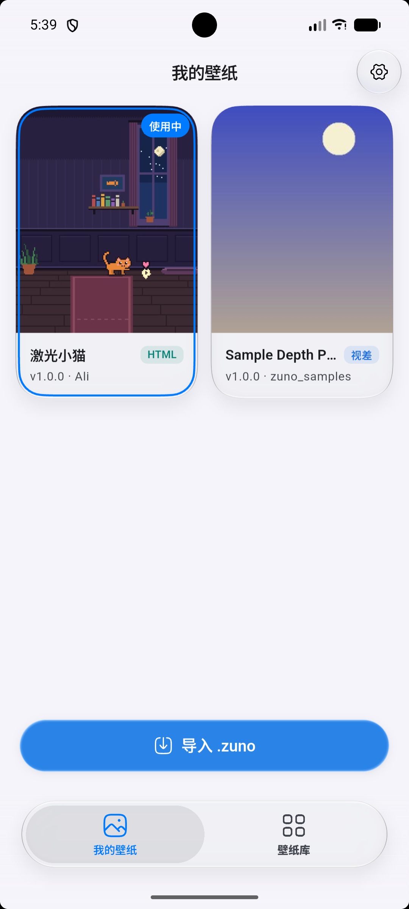
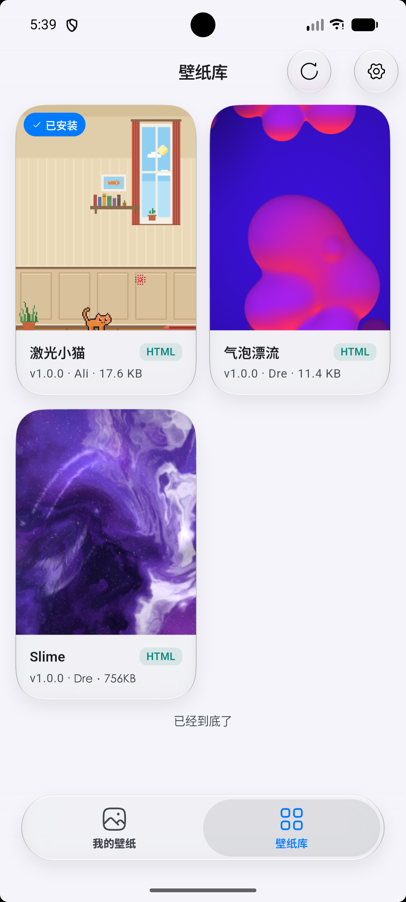

<p align="center">
  
</p>

<h1 align="center">ZUNO</h1>

<p align="center">
  <strong>Android 动态壁纸应用——视频、深度视差、HTML、定时四类壁纸。</strong><br/>
  Flutter 只负责管理界面；真正画在桌面上的内容由原生 <code>WallpaperService</code> 完成，不走 Flutter 渲染链路。
</p>

<p align="center">
  <a href="https://github.com/Zephyr-Isle/ZUNO/actions/workflows/ci.yml"></a>
  <a href="https://github.com/Zephyr-Isle/ZUNO/releases/latest"></a>
  <a href="LICENSE"></a>
</p>

<p align="center">
  <a href="README.md">English</a> · 简体中文
</p>

---

## 目录

- [功能](#功能)
- [支持的语言](#支持的语言)
- [截图](#截图)
- [下载与安装](#下载与安装)
  - [示例壁纸包](#示例壁纸包)
- [软件构建](#软件构建)
  - [Android App](#android-app)
  - [桌面管理端](#桌面管理端)
  - [后端（本地开发）](#后端本地开发)
- [壁纸包制作](#壁纸包制作)
  - [目录结构](#目录结构)
  - [manifest 字段](#manifest-字段)
  - [四类壁纸对 content/ 的要求](#四类壁纸对-content-的要求)
  - [checksum 算法](#checksum-算法)
  - [导入校验顺序](#导入校验顺序)
  - [制作一个壁纸包（step by step）](#制作一个壁纸包step-by-step)
- [后端部署](#后端部署)
  - [方式 A:Docker 自托管（推荐）](#方式-a--docker-自托管推荐)
  - [方式 B:Cloudflare Workers](#方式-b--cloudflare-workers)
  - [WebDAV 目录约定](#webdav-目录约定)
  - [让 App 连上你的后端](#让-app-连上你的后端)
- [致谢](#致谢)
- [许可证](#许可证)

## 功能

- **视频壁纸**：ExoPlayer 直接把画面写进 Surface，解码后基本不用再拷贝一次。解码方式可选自动、硬解或软解；硬解失败会明确提示，不会悄悄降级。
- **深度视差**：EGL14 + GLES20 的单 pass 位移映射，靠加速度计和陀螺仪驱动，也允许包里带自己的 GLSL 着色器。
- **HTML 壁纸**：离屏 WebView 软件绘制到壁纸 Surface，沙箱只放行 `appassets.local`；页面静止时自动停帧。
- **定时壁纸**：WorkManager 按规则切换 slot 子壁纸，切换通过进程内 `ConfigBus` 热更新。受平台限制，最小周期是 15 分钟。
- **壁纸包**：`.zuno` 就是 ZIP，带 manifest 和 checksum；导入时会拦住 Zip Slip、路径穿越、过高的 minSdk，并递归检查 timed 子包。
- **云端目录**：浏览和下载不用登录，票据 5 分钟有效；上传、删除都放在独立的管理端里。
- **8 种界面语言**：英语、简体中文、繁体中文、日语、韩语、西班牙语、法语、德语，可在应用内切换或跟随系统。

## 支持的语言

界面共支持 8 种语言：

| 语言 | 代码 | 本地名称 |
|---|---|---|
| 英语 | `en` | English |
| 简体中文 | `zh` | 简体中文 |
| 繁体中文 | `zh_Hant` | 繁體中文 |
| 日语 | `ja` | 日本語 |
| 韩语 | `ko` | 한국어 |
| 西班牙语 | `es` | Español |
| 法语 | `fr` | Français |
| 德语 | `de` | Deutsch |

默认跟随系统语言；如需指定，打开 **设置 → 语言** 选择一种语言（或切回 **跟随系统**）。选择结果保存在原生配置中，并在首帧渲染前读取，因此启动时不会先闪一帧错误语言。

各语言文案位于 `lib/l10n/strings_<code>.dart`。`ZunoStrings` 是纯 Dart 实现（不依赖 Flutter），因为 ZIP 导入在后台 isolate 中执行，语言码通过参数显式传入。新增语言时，复制 `strings_en.dart` 翻译各条目，然后在 `ZunoStrings.supportedLanguageCodes` / `nativeNames` 注册语言码，并把对应 locale 加入 `ZunoLocalizations.supportedLocales`。

## 截图

<table>
  <tr>
    <td align="center"></td>
    <td align="center"></td>
  </tr>
  <tr>
    <td align="center"><b>我的壁纸</b><br/>已安装的包、当前使用中状态和导入入口</td>
    <td align="center"><b>壁纸库</b><br/>云端目录、类型与体积，点一下就能下载</td>
  </tr>
</table>

## 下载与安装

到 [**Releases**](https://github.com/Zephyr-Isle/ZUNO/releases/latest) 页面取最新构建：

- `ZUNO-<version>.apk`——通用 APK（arm64 / armv7a / x86_64，Android 7.0+）。CI 构建使用 debug 签名，侧载安装没有问题；正式分发请用你自己的签名，见[软件构建](#软件构建)。
- `*.zuno`——示例壁纸包，也可以当格式参考（见[下表](#示例壁纸包)）。

安装步骤：

1. 安装 APK（系统询问时允许「安装未知应用」）。
2. 打开 ZUNO → **导入** → 选一个 `.zuno` 文件（在下载目录里，或用文件管理器分享给 ZUNO）。
3. 在详情页调参数 → **应用此壁纸** → 到系统壁纸预览页点「设置壁纸」确认。

Android 不允许普通应用静默设置动态壁纸，最后一步系统确认绕不开。

### 示例壁纸包

| 包 | 类型 | 大小 | 说明 |
|---|---|---|---|
| [sample_depth](https://github.com/Zephyr-Isle/ZUNO/releases/latest) | depth | 3 KB | 生成的演示包：内置素材的深度视差 |
| [sample_html](https://github.com/Zephyr-Isle/ZUNO/releases/latest) | html | 1 KB | 生成的演示包：最小 HTML 壁纸 |
| [sample_timed](https://github.com/Zephyr-Isle/ZUNO/releases/latest) | timed | 3 KB | 生成的演示包：定时 slot 切换 |
| [lantern-sky](https://github.com/Zephyr-Isle/ZUNO/releases/latest) | html | 150 KB | 灯笼夜空 |
| [laser-kitty](https://github.com/Zephyr-Isle/ZUNO/releases/latest) | html | 20 KB | 激光小猫 |
| [liquid-contour](https://github.com/Zephyr-Isle/ZUNO/releases/latest) | html | 241 KB | 液态等高线 |
| [mycelium](https://github.com/Zephyr-Isle/ZUNO/releases/latest) | html | 190 KB | 菌丝流影 |
| [particle-field](https://github.com/Zephyr-Isle/ZUNO/releases/latest) | html | 257 KB | 粒子场 |
| [rain](https://github.com/Zephyr-Isle/ZUNO/releases/latest) | html | 1.4 MB | 雨窗（包内保留原始 `license.txt` 与图库署名） |
| [slime](https://github.com/Zephyr-Isle/ZUNO/releases/latest) | html | 159 KB | Slime |
| [steam-glass](https://github.com/Zephyr-Isle/ZUNO/releases/latest) | html | 1.9 MB | 蒸汽玻璃 |

多数展示包改编自 [Lively Wallpaper](https://github.com/rocksdanister/Lively) 项目的网页壁纸。每个包都保留原作者附加的授权信息（`rain` 的 `content/license.txt` 里注明了 Pexels/Unsplash 图库素材来源）。导入方式与其他 `.zuno` 相同。

## 软件构建

### Android App

前置：Flutter 3.47+（Dart 3.13+）、JDK 17、Android SDK（compileSdk 37）。

```bash
flutter pub get
flutter run                 # 调试构建，跑在连接的设备 / 模拟器上
flutter build apk --release
```

- release 构建在 `build/app/outputs/apk/release/` 下产出 4 个 APK：`armeabi-v7a`、`arm64-v8a`、`x86_64` 三个分包 + 一个 universal 包，已开启 R8 混淆。
- 没有 `android/key.properties` 时，release 构建自动回退到 debug 签名（能正常安装，但不要当正式版本分发）。要正式签名，创建 `android/key.properties`（已被 gitignore），写入 `storeFile`、`storePassword`、`keyAlias`、`keyPassword` 指向你的 keystore。
- 版本号来自 `pubspec.yaml` 的 `version: 1.0.0+1`（→ `versionName` 1.0.0、`versionCode` 1），Gradle 自动读取。
- 单元测试不需要设备：`flutter test`（`samples/` 目录同时是测试 fixture）。

### 桌面管理端

Tauri 2 应用，负责云端目录的上传与管理。前置：Node 22+、Rust stable、WebView2（Windows）。

```bash
cd desktop
npm install
npm run tauri dev      # Vite 开发服务器 :1420 + Rust 调试窗口
npm run tauri build    # 产物在 src-tauri/target/release/bundle/
```

### 后端（本地开发）

```bash
cd backend
npm install
npm run typecheck            # Worker 代码
npm run typecheck:selfhost   # Node 自托管适配层
npm run dev                  # wrangler dev —— D1 映射到本地 SQLite 文件
node tool/stub-webdav.mjs .tmp-dav 8799   # 本地 WebDAV stub，联调用
```

## 壁纸包制作

### 目录结构

`.zuno` 说到底就是个 ZIP（store / deflate 都行）：

```
zuno-root/
├── manifest.json            # 必需，根目录或单一顶层文件夹内
├── thumbnail.png            # 可选，建议 480×800、<200KB
└── content/                 # 必需，非空，所有壁纸素材
```

### manifest 字段

| 字段 | 说明 |
|---|---|
| `schemaVersion` | 目前固定为 1 |
| `id` / `version` | id 用反向域名或 UUID，同 id 再导入会覆盖旧版本；version 走语义化版本 |
| `title` | 库里显示的名字 |
| `type` | `video` / `depth` / `html` / `timed` |
| `entry` | 入口文件相对包根的路径，必须真实存在 |
| `minSdk` | 默认 24，高于设备 API 就拒绝导入 |
| `checksum` | `sha256-` 加小写 hex，覆盖 `content/` 下所有文件 |
| `config` | 可调参数声明，支持 float / int / bool / color |
| `capabilities` | 记录 `network` / `pointer` / `sensors`；v1 里网络只是记录，并不放行 |

### 四类壁纸对 content/ 的要求

- `video`：`content/main.mp4`，H.264/H.265，建议做成 ≤15 秒的循环。
- `depth`：`content/color.jpg` 和 `content/depth.png`（灰度、同尺寸、必需），可选 `content/shader.glsl`。
- `html`：`content/index.html` 加上包内自包含资源，沙箱里访问不到外部 CDN。
- `timed`：`content/schedule.json` 加 `content/slot_*/`，每个 slot 是独立子包，但不能再嵌套 timed。

### checksum 算法

`content/` 下的文件按相对包根的 POSIX 路径升序排列，依次把「路径 UTF-8 字节 + `0x0A` + 文件字节」喂进同一个 SHA-256，最后写成 `sha256-<小写 hex>`。

### 导入校验顺序

路径遍历 → manifest 存在 → 必填字段 → type → entry → content 非空 → minSdk → checksum → timed 递归。任何一步没过，整包都会被拒，并给出具体原因。

### 制作一个壁纸包（step by step）

1. 建源目录：

   ```
   my-wallpaper/
   ├── manifest.json
   └── content/
       └── index.html
   ```

2. 写最小 manifest（以 HTML 为例）：

   ```json
   {
     "schemaVersion": 1,
     "id": "com.example.my-wallpaper",
     "version": "1.0.0",
     "title": "我的壁纸",
     "type": "html",
     "entry": "content/index.html"
   }
   ```

3. 打包——两种方式都会替你重算 checksum：
   - **桌面管理端**：「从源目录打包」会先校验 manifest 和 entry、重算 checksum，没有 `thumbnail.png` 时自动生成。
   - **命令行**：把一个或多个包目录放进 staging 目录，然后

     ```bash
     dart run tool/pack_zuno.dart --src <staging 目录> --out <输出目录>
     ```

4. 把产出的 `.zuno` 导入 App 验证效果，需要进云端目录时再用管理端上传。

[`samples/`](samples/) 里的 11 个包是最好的参考样板——解开任何一个，结构都与上面完全一致。

## 后端部署

后端（`backend/`）为 App 的壁纸库提供服务：目录列表、5 分钟下载票据、整包流式转发。它不依赖任何数据库服务——只用 SQLite 语义，真正的包文件放在 WebDAV 上。

### 方式 A:Docker 自托管（推荐）

两个容器：`zuno-api`（本仓库后端，Node）+ WebDAV 服务（存放包与封面）。全程约 5 分钟。

```bash
git clone https://github.com/Zephyr-Isle/ZUNO
cd ZUNO/backend
cp selfhost.env.example .env          # 填入各个 secret
cp webdav.example.yml webdav.yml      # 默认配置即可用
docker compose up -d
curl http://127.0.0.1:8080/health     # {"ok":true,"database":"ok",...}
```

`.env` 环境变量：

| 变量 | 使用方 | 说明 |
|---|---|---|
| `WEBDAV_BASE` | zuno-api | WebDAV 根地址。保持 `http://webdav:6065`（compose 内网服务名） |
| `WEBDAV_USER` / `WEBDAV_PASS` | zuno-api | **只读** WebDAV 账号（`zuno-api` 用户）；Worker 对存储永远只读 |
| `TICKET_SECRET` | zuno-api | 下载票据的 HMAC 密钥，≥ 32 字节随机串。泄露只影响伪造下载链接 |
| `ADMIN_SECRET` | zuno-api | `/api/admin/sync`、`/api/admin/delete` 的口令 |
| `PBKDF2_ITERATIONS` | zuno-api | 口令哈希强度；没有 Cloudflare 的 10ms CPU 限制，`100000` 随便用 |
| `WEBDAV_ADMIN_PASSWORD` | webdav | 桌面管理端使用的读写账号（admin）密码 |
| `WEBDAV_API_PASSWORD` | webdav | 只读账号（zuno-api）密码，必须与 `WEBDAV_PASS` 相同 |

secret 用 `openssl rand -base64 32` 逐个生成。

- 数据在两个命名卷里：`zuno-db`（SQLite，`DB_PATH=/data/zuno.db`）和 `zuno-dav`（`packages/` + `covers/`）。
- 缺配置也能启动：`/health` 正常，相关接口返回 `server_misconfigured` 并列出缺失项——看 `docker compose logs zuno-api` 就能对着补。
- 升级：`docker compose pull && docker compose up -d`（想本地构建就取消 compose 里 `build: .` 的注释）。

**上传壁纸包并同步：**

1. 桌面管理端 → 设置 → API 地址填 `http://<主机>:8080`、Admin Secret、WebDAV 填 `http://<主机>:6065` 加 admin 账号。
2. 上传包（本地文件或从源目录打包）。上传链路自动完成：包写入 WebDAV → 封面写到 `covers/<id>.png` → 调 `POST /api/admin/sync?id=<id>` 让目录生效。
3. App → 设置 → 壁纸库地址填 `http://<主机>:8080`。

### 方式 B:Cloudflare Workers

最初的部署目标——Workers + D1 + WebDAV（没有 R2）。Worker 负责 API、鉴权、下载票据和整文件流式转发；D1 放用户、会话和壁纸元数据；真正的 `.zuno` 包和封面放在你自己的 WebDAV 上。Worker 对 WebDAV 只读，上传由管理端直连。

```bash
cd backend
npm install
cp wrangler.toml.example wrangler.toml   # 填 database_id、域名和 WEBDAV_BASE

npx wrangler d1 create zuno
npm run db:init:local
npm run db:init:remote

npx wrangler secret put WEBDAV_USER
npx wrangler secret put WEBDAV_PASS
npx wrangler secret put TICKET_SECRET      # 至少 32 字节随机串
npx wrangler secret put ADMIN_SECRET

npm run deploy
```

免费版容易踩的坑：

- WebDAV 单独开个只读账号，只授权 ZUNO 目录，强制 HTTPS 和长随机密码。密钥只通过 `wrangler secret` 设置，别写进仓库。
- 下载按整包流式返回，不承诺 `206` 或断点续传。Workers 的 `fetch` 子请求会剥掉 `Range`，上游永远回 200，客户端拿到整文件就算对。
- 免费版单请求只有 10ms CPU，PBKDF2 取了 10000 次。同步壁纸别一次扫全量：用 `POST /api/admin/sync?id=<包id>` 单包同步；真要全量扫描，就按 `offset` / `limit` 一页页跑，直到 `nextOffset` 为 null。

### WebDAV 目录约定

```
<WEBDAV_BASE>/
  packages/<id>/<version>/<id>-<version>.zuno
  covers/<id>.png
```

每个版本目录里还应有一份 `manifest.json` 旁车文件（管理端上传时自动写入）。少了它，Worker 只能对不超过 16MB 的包尝试从 ZIP 里读 manifest，更大的包会被跳过。

### 让 App 连上你的后端

ZUNO **不内置任何服务器**。打开 App → 设置 → 壁纸库地址，填你部署的 base URL（比如 `https://api.example.com` 或 `http://192.168.1.10:8080`），保存后立即重建目录；「清除地址」会让壁纸库回到未配置的引导状态。

## 致谢

- [Lively Wallpaper](https://github.com/rocksdanister/Lively)——多数展示包改编自其网页壁纸合集。
- [liquid_glass_widgets](https://pub.dev/packages/liquid_glass_widgets)——液态玻璃 UI 组件库。
- [Media3 / ExoPlayer](https://github.com/androidx/media)——视频解码。
- [Tauri](https://v2.tauri.app/)——桌面管理端框架。
- [hacdias/webdav](https://github.com/hacdias/webdav)——自托管 compose 里内置的 WebDAV 服务。
- `rain` 包内的图库素材署名见其 `content/license.txt`（Pexels / Unsplash）。

## 许可证

本项目以 [MIT](LICENSE) 协议开源。壁纸包内容保留各自的授权与署名——重新分发前请查看 `manifest.json` 与包内的 `content/license.txt`。
